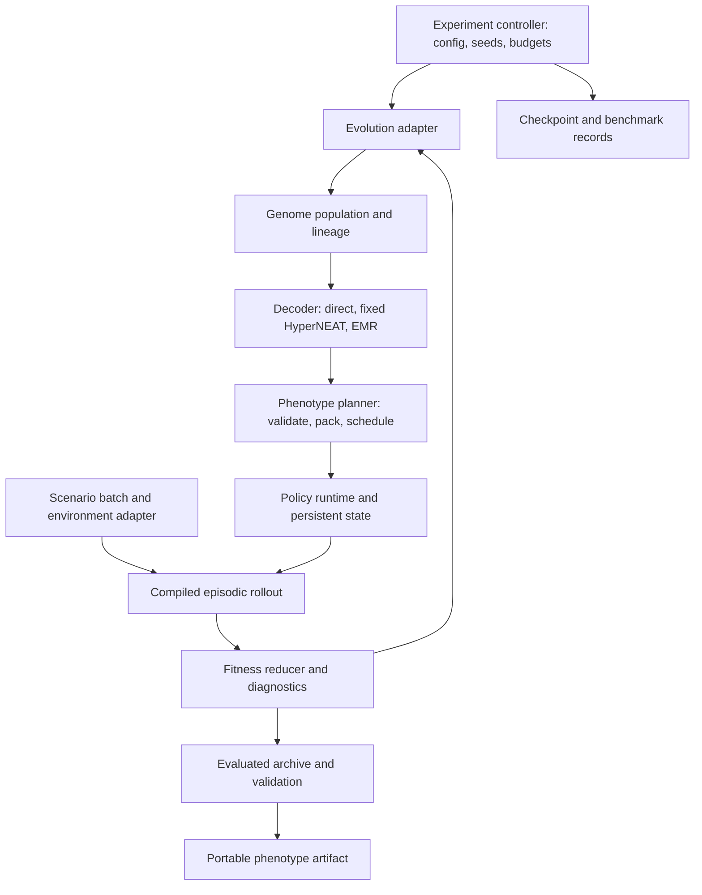

# Refined architecture specification

Status: proposed development blueprint, November 10, 2026. Existing capabilities are distinguished from project work. Numerical performance targets in the benchmark specification are acceptance policies, not measurements. The README lists the revisions.

## 1. Outcome and architectural decisions

Build an application-independent JAX engine that evolves compact genotypes, decodes bounded executable graphs, and evaluates stateful agents in sequential environments. Adaptive EMR-HyperNEAT is a required project outcome, not an optional replacement for finishing the platform.

The main decisions are:

1. Reuse TensorNEAT’s evolutionary machinery behind an adapter. Preserve its structural gene identity and reproduction semantics.
2. Support direct, fixed-substrate, and adaptive EMR decoders through one phenotype contract.
3. Make persistent recurrent state explicit from the first milestone. Recurrence across observations and settling within one observation are separate semantics. Substrate decoders use a persistent layered profile whose actions reflect the current observation; direct recurrent genomes use a persistent synchronous profile whose delays are stated and measured.
4. Use a general directed-graph representation with finite resource budgets. Modules are optional annotations or optimizations, not required topology templates.
5. Compile evolution, decoding, planning, policy execution, and rollout separately for testing and profiling. Do not compile the entire generation initially.
6. Keep the control plane small: one Python process, validated configuration, files for results, and explicit backend selection. No distributed service, plugin registry, dashboard, or workflow platform initially.
7. Separate software correctness, research outcomes, and hardware performance qualification. A CPU success cannot satisfy a GPU acceptance gate.

## 2. Components and dependencies



| Component | Owns | Depends on | Initial implementation |
|---|---|---|---|
| Genome adapter | Native genome tensors, lineage, capacity metadata | TensorNEAT | Thin wrapper; no second NEAT gene implementation |
| Evolution adapter | Initialize, ask/tell, selection, mutation, crossover, species state | Genome adapter, fitness vector | Reuse TensorNEAT; audit sign, ordering, tie and invalid-fitness behavior |
| Decoder | Genotype-to-graph development | Genome batch, static decoder settings | Direct extraction; then coordinate queries; then EMR |
| Phenotype planner | Validity, index remapping, masks, execution schedule, bucket assignment | Decoded graph | Custom pure functions; one fixed capacity at first |
| Policy runtime | Numerical node updates and state initialization | Planned phenotype | Custom JAX implementation plus NumPy reference |
| Environment adapter | Reset, observation, transition, termination semantics | Scenario description | Tiny memory task; Gymnax adapter |
| Evaluator | Population/scenario batching, sequential rollout, statistics | Policy, environment | Custom JAX scan; bounded result arrays |
| Fitness reducer | Objective, constraints, scenario aggregation, cross-generation comparability policy | Episode summaries | Scalar maximize objective initially |
| Experiment controller | Run lifecycle, budgets, seeds, archive, checkpoints | All interfaces above | Small Python driver |

The core may import JAX and NumPy. TensorNEAT and EMR imports remain inside adapters. Environments never import the evolution backend. The runtime never imports a trading application or a genome library. Backend-specific workarounds are localized and tested.

TensorNEAT supplies the first implementation of selection, mutation, crossover and speciation; those operators do not need a second project implementation. Parameter/offspring operations can be batched, while speciation and structural edits have bounded bookkeeping and possible coordination costs. Preserve their actual upstream behavior first, time them independently, and only then consider alternative species assignment. Execution buckets group computational shapes and must never silently replace evolutionary species.

## 3. Interface contracts

These are proposed interfaces, not existing upstream API signatures. Implement them as small functions and immutable data containers/PyTrees; introduce Python protocols only where a second implementation needs them.

| Operation | Inputs | Outputs and invariant |
|---|---|---|
| Initialize evolution | Config, root key | Population state with exactly P candidate IDs |
| Ask | Population state | Candidate batch plus immutable evaluation IDs; document whether ask changes backend state |
| Decode | Candidate batch, decoder settings | Graph batch, validity/overflow flags, decoding statistics |
| Plan | Graph batch, runtime configuration | Executable batch, original-index mapping, plan signature |
| Initialize policy | Executable batch, episode descriptors | Independent state per candidate and episode |
| Policy step | Phenotype, policy state, observation, explicit key if stochastic | Action and next state; no hidden Python state |
| Environment reset/step | Scenario/key; then state and action | Observation, reward, next state, terminated, truncated, diagnostics |
| Evaluate | Candidate/executable batch, scenarios, shared scenario data, rollout settings | Scores and sufficient statistics indexed by original candidate ID |
| Tell | Ask token/population state and associated scores | Next population state; reject stale or misordered results; scores follow the declared comparability policy in section 5 |
| Export | Evaluated candidate, decoder/runtime configuration | Genome plus portable phenotype and complete interpretation metadata |

Separate static metadata (capacity, dtype, semantics, activation vocabulary) from dynamic array values. A topology change within capacity must not become a new static argument. Do not pass population tensors as compile-time constants or recreate jitted closures each generation.

### State and shapes

- EvolutionState: native gene arrays, species/history state, RNG state, generation, candidate IDs. Backend-owned internals remain opaque to application code.
- GraphBatch: node mask [p,N], node bias and activation IDs [p,N], input/output mappings, optional coordinates, graph execution semantics, and connectivity in one of two declared encodings. The edge-list encoding holds edge source/target, weights, masks and delay labels as [p,E]. For the layered profile, dense connectivity uses separate weight matrices W_zero and W_delay, each [p,N,N], with separate validity masks: W_zero contains immediate edges and W_delay contains unit-delay edges. Their values are never merged into a single adjacency for execution.
- Substrates may retain the existing role-shaped storage instead of allocating full adjacency matrices: W_in [p,I,H] and W_out [p,H,O] are immediate, while hidden connectivity is separated into W_hh_zero and W_hh_delay [p,H,H], each with its own mask. This represents immediate forward and delayed recurrent connections in the same hidden population. A single-hidden-population profile needs only W_in, W_hh_delay and W_out; the absent immediate hidden block is fixed by the profile, not changed per genome. These are fixed schemas, not a generic block-management framework.
- A decoder emits its natural encoding. Direct genomes emit edge lists; fixed and EMR substrates emit dense blocks. Edge capacity E bounds only the edge-list encoding; dense blocks are bounded by N and the memory budget. Conversion between encodings is lossless and tested on fixtures small enough to hold both. Never route a substrate through an edge list merely to reach the runtime.
- ExecutionPlan: compacted index maps, masks, layer schedule where applicable, capacity/bucket signature, and backend-specific numerical layout.
- PolicyState: activations [p,B,N] initially; later an explicitly versioned PyTree can carry additional memory. No population-level shared hidden state.
- EvaluationState: environment state [p,B,...], active/done masks, accumulated rewards, diagnostics, and scenario/time indices.
- ScenarioData: read-only arrays shared by every candidate and episode, such as one long recorded sequence. It is passed once per evaluation as a dynamic argument. It is never copied per candidate, never vectorized over, and never closed over as a compile-time constant. Episodes read it through their own scenario/time indices.

P is logical population size; p is a device microbatch; B is concurrent episodes. Candidate order is restored before tell. Executable phenotypes need not all coexist on device.

Use finite padding and explicit masks in project-owned tensors. Sanitize padded indices before gathers and mask with selection, not multiplication by potentially NaN values. Preserve TensorNEAT’s internal padding conventions only within its adapter.

## 4. Graph freedom and precise temporal semantics

The canonical representation permits any directed connectivity within its declared size limits, including self-loops, disconnected nodes, irregular degree, and cross-links. It does not require modules, locality, an acyclic graph, or a fixed neuron layout. Resource limits constrain size; optional locality priors constrain search and must be labeled separately.

Support three explicit execution profiles:

**DAG profile:** evaluate nodes in topological layers within an observation. Reject cycles. This provides direct feedforward and fixed-HyperNEAT compatibility tests. A layer schedule is bounded and masked; converting an arbitrary DAG into synchronous updates is not an invisible optimization.

**Persistent layered profile (primary for fixed-substrate and EMR decoders):** every edge carries a delay label of 0 or 1. Zero-delay edges form a DAG and are evaluated in topological layers within the observation. Unit-delay edges read the state retained from the previous observation. For one hidden population this is h_t = f(x_t·W_in + h_{t-1}·W_hh + b_h) and y_t = g(h_t·W_out + b_y); the carried state is h_t, and the action at observation t reflects observation t. With no unit-delay edges the profile equals the DAG profile, so an EMR feed-forward phenotype must reproduce upstream feed-forward outputs under it. Reset clears the retained state.

Delay labels come from declared structure, never from coordinate order. In a substrate decoder, input-to-hidden and hidden-to-output edges are zero-delay, and every hidden-to-hidden edge within one population is unit-delay, self-loops included. A fixed substrate that declares several hidden layers labels forward edges between consecutive declared layers zero-delay and all lateral, backward and self edges unit-delay. The zero-delay subgraph is then acyclic by construction. Any other decoder that emits delay labels must pass a cycle check on its zero-delay subgraph.

The planner builds its topological schedule from the immediate mask only. At observation t, delayed contributions read an unchanged snapshot of state at t-1 while immediate contributions use values computed in the current topological pass. Compaction and export preserve both matrix/mask sets, node ordering and the encoding/profile version. A two-hidden-layer fixture with immediate forward edges and delayed feedback must survive edge-list/dense conversion and export/reload without changing its trajectory.

**Persistent synchronous profile (direct recurrent genomes):** clamp inputs to the current observation, copy the prior episode state, and perform K simultaneous updates of non-input nodes. Each internal update reads the previous internal state; it never sees another node’s partially updated value. Read actions after update K and carry the resulting state to the next observation. K is fixed per runtime profile, initially 1. Bias and activation apply only to non-input nodes; reset clears state before processing the first observation. Input edges act immediately through clamped values; hidden-to-hidden paths propagate over internal updates and/or observations.

This profile represents arbitrary cycles with well-defined delays, which is why it serves direct recurrent genomes that carry no delay labels. Its cost is stated here so that it is not rediscovered later. At K=1 a path through n hidden nodes reaches the output n observations after the input. A NEAT add-node mutation splits a connection, so it inserts one observation of delay and is not behavior-preserving. Changing K changes the policy, not merely speed. A fixture measures the reaction latency, and every result from this profile reports it. Do not use this profile for substrate phenotypes: their outputs would always act on the hidden state of the previous observation. Because the two persistent profiles differ in timing, results across decoders are compared under the comparison protocol in benchmarks.md, which separates system comparisons from encoding-isolating ones.

EMR’s existing recurrent path resets hidden state for each input. Preserve an upstream-compatible settling profile for comparison, then evaluate EMR phenotypes with persistent carry under the layered profile, named separately. The layered profile with hidden-to-hidden edges removed is the parity bridge to upstream feed-forward outputs. Do not claim paper-equivalent behavior after changing recurrence semantics. [EMR architecture](https://github.com/RomainClaret/emr-hyperneat/blob/main/docs/architecture.md)

The initial dense masked runtime is a reference-quality GPU path for small graphs. Later edge-list/segmented reduction, block-sparse, or dense-per-cluster layouts may accelerate the same graph. A conversion must preserve edge weights, activation rules, update timing, and output mapping. Runtime partitioning may reorder computation only where semantics permit it. If an optimization drops edges or caps degree, it is a new search/runtime constraint, not a lossless planner optimization.

## 5. One complete generation

1. Derive training scenarios from run seed, generation, and stable scenario IDs. Use shared scenarios across competing candidates; keep mutation, environment, and policy randomness in separate streams.
2. Ask for candidate genomes. Attach stable evaluation IDs and preserve the evaluated generation until its scores are archived.
3. Decode candidates in fixed-size chunks. Generate coordinates/queries in bounded slabs where needed. Record candidate-grid size, active nodes, edges, overflow, and invalid values separately.
4. Plan each valid graph. Initially use one capacity; later assign fixed-size buckets and pack them with a permutation. Pad tail batches. Reject or explicitly promote over-capacity graphs; never silently truncate.
5. Initialize per-episode environment and policy state. Run a compiled scan over observations, vectorized over candidates and episodes. Finished episodes stop contributing; truncation is recorded separately from terminal success/failure.
6. Reduce episode summaries to fitness and validity flags. Restore original candidate ordering. Invalid candidates receive the adapter’s documented worst score; an entirely invalid population stops with a diagnostic rather than breeding indefinitely.
7. Archive the evaluated winner and validation candidates before tell. Update species/reproduction through TensorNEAT and advance keys/state. Validation results do not enter training reproduction unless that is an explicitly different experiment.
8. At configured boundaries, read compact summaries and save atomic checkpoints. Host synchronization is allowed for reporting, not for each candidate or timestep.

### Cross-generation fitness comparability

TensorNEAT keeps records across generations. A species is marked stagnant when its current fitness fails to exceed a stored historical best, and fitness-proportional spawn allocation also reads stored bests. [TensorNEAT species](https://github.com/EMI-Group/tensorneat/blob/main/src/tensorneat/algorithm/neat/species.py) Generation-specific scenarios shift the score scale from one generation to the next, so a lucky draw can set a best that later generations cannot beat, and species are then removed by noise. V3 confirms this behavior at the pinned fork SHA. Every experiment manifest declares one policy; each has a side effect.

| Policy | Side effect |
|---|---|
| Fixed training scenarios in every generation | Comparable scores; selection can overfit that scenario set |
| Score relative to a reference computed on the same scenarios, such as a fixed reference policy | Comparable scale; needs a meaningful reference |
| Within-generation rank transform before tell | Stable scale; a species that has led once cannot beat its own best rank, so stagnation changes meaning |
| Generation-specific scenarios with stagnation relaxed and rank-based spawn allocation | Keeps resampling; loses stagnation pressure |

M1 keeps generation-specific shared scenarios, records species removed by stagnation each generation, and compares against a fixed-scenario control run. The policy for later milestones is chosen from that evidence and entered in the decision log before M2 acceptance runs.

### Caching

No fitness cache is valid across changed scenarios merely because the genome is unchanged. Phenotype caching, if later justified, must include genome content, decoder settings/version, runtime interpretation, and precision. Keep upstream slot-indexed recurrent caching disabled. [EMR configuration](https://github.com/RomainClaret/emr-hyperneat/blob/main/docs/configuration.md)

## 6. Technology and dependency strategy

Use Python 3.11 initially, JAX/JAXlib, NumPy for the independent reference, pytest, and simple JSON configuration/results. Use dataclasses/PyTrees rather than a broad modeling framework. Add Gymnax only for its environment adapter. Project code uses no neural-layer framework, but Gymnax declares Flax as a runtime dependency and constrains JAX itself; version 1.0.1 requires JAX >=0.6,<0.12. Resolve and lock Gymnax with its transitive packages in Q0 against the EMR JAX and NumPy pins, not in V4. If no resolution satisfies every pin, decide in Q0 between an older Gymnax release and a separate environment lane, and record the decision. [Gymnax dependencies](https://github.com/RobertTLange/gymnax/blob/main/pyproject.toml) The fixed-topology weight-only baseline in the roadmap is project-owned and needs no added dependency. Optax, evosax, JaxMARL, and physics suites are later optional experiments.

Correctness tests and baseline benchmarks use FP32 arrays with `jax_default_matmul_precision="float32"`, configured before tracing. Audit per-operation precision overrides in project and dependency code so they do not weaken this policy. Record the effective policy in experiment manifests, checkpoints, exports and benchmark reports; apply it equally to CPU and GPU runs. The independent NumPy reference computes in float64 from the same FP32-representable inputs and weights. Reduced-precision execution is a separately labeled future experiment, not an automatic fallback. See the [numerical acceptance policy](benchmarks.md) and [JAX precision documentation](https://docs.jax.dev/en/latest/_autosummary/jax.default_matmul_precision.html).

As reviewed, EMR reports version 0.3.0 and requires JAX/JAXlib >=0.5,<0.7 plus NumPy <2. Its published-result environment pins JAX 0.6.1 and a TensorNEAT fork submodule. Start qualification with that version and its CUDA 12 installation path; do not upgrade to current JAX/CUDA releases without a separate compatibility assessment. [Version](https://github.com/RomainClaret/emr-hyperneat/blob/main/emr_hyperneat/_version.py), [dependencies](https://github.com/RomainClaret/emr-hyperneat/blob/main/pyproject.toml), [installation](https://github.com/RomainClaret/emr-hyperneat/blob/main/docs/installation.md)

Use one pinned Linux/amd64 Docker image with separate execution profiles:

| Lane | Purpose | Version policy |
|---|---|---|
| Reference CPU | Correctness and upstream reproduction inside Docker | Same image, explicit CPU backend, no GPU reservation |
| RTX 3060 | CUDA evolution and evaluation inside Docker | Pinned JAX/JAXlib/CUDA plugin and userspace libraries; card-specific resource profile |
| RTX 3070 | CUDA evolution and evaluation inside Docker | Same image and semantic configuration; independently measured resource profile |

Record full source SHAs at implementation time; a release label or floating main is insufficient. Prefer the EMR-pinned TensorNEAT fork for the integrated lane. Test upstream TensorNEAT in a separate environment if needed; never install competing packages with the same import name together. Qualify both operator parity and solver behavior before swapping forks.

Start with adapters and unmodified dependencies. If a public integration seam is missing, maintain a small, pinned patch branch with tests and upstream it when practical. Do not fork the full engine preemptively. Never patch global JAX behavior in core code. Retain dependency license notices and review redistribution requirements before choosing a distribution model; both project repositories expose GPL licensing.

The execution stack is Windows, an up-to-date WSL 2 kernel, Docker Desktop using Linux containers, and the project’s CUDA-enabled image. The Windows NVIDIA driver remains a host prerequisite; all Python dependencies, tests, evolution, evaluation and benchmark commands run in containers. JAX uses Linux CUDA wheels here; native Windows Python is not the target. JAX still labels Windows WSL2 GPU support experimental, so actual workload qualification remains required. [Docker GPU support](https://docs.docker.com/desktop/features/gpu/), [JAX platforms](https://docs.jax.dev/en/latest/installation.html)

See [Windows and Docker execution](execution-environment.md) for image ownership, mounts, caches, device selection and host setup. Qualify the 3060 and 3070 separately; do not assume equal VRAM, combined memory, or co-location. On a shared host, assume both cards are visible inside every container and select one in-container before JAX starts. A GPU startup failure must stop a GPU run rather than silently fall back to CPU. A separately requested CPU reference run remains available for debugging. The same image can later be qualified on native Linux if a WSL-specific issue prevents a required capability.

### Proposed package shape; create only as needed

```text
src/neuroevo/
  contracts.py          # shared state/container definitions
  evolution/            # TensorNEAT adapter
  decoding/             # direct, fixed substrate, EMR
  planning.py           # graph validation and layout selection
  runtime/              # reference and JAX graph execution
  evaluation/           # rollout, metrics, scenarios
  environments/         # memory task and suite adapters
  experiments/          # small driver, checkpoint/export
tests/                  # unit, contract, differential, integration
benchmarks/             # workload definitions and reports
configs/                # committed experiment manifests
locks/                  # qualified environment constraints
Dockerfile              # planned pinned Linux/amd64 environment
compose.yaml            # planned CPU and per-GPU execution profiles
.dockerignore           # planned exclusion of artifacts and local environments
docs/                   # this blueprint and benchmark decisions
```

## 7. Network complexity versus agent complexity

| Capability | Mechanism | Status |
|---|---|---|
| Small evolving graphs and CPPNs | TensorNEAT genes/operators | Reused early |
| Fixed coordinate-generated connectivity | HyperNEAT decoder | Early integration |
| Adaptive hidden positions and connectivity | EMR discovery | Required core milestone |
| Per-node activations/aggregation, neuromodulation | EMR options with feature restrictions | Selected combinations qualified later |
| Persistent temporal memory | Explicit policy state and custom runtime | First milestone |
| General modular/hierarchical graph motifs | Graph representation can express them | No promise evolution will discover useful motifs |
| Module duplication, reusable subprograms, role genes | New encoding and mutation/crossover semantics | Future research |
| Multiple timescales, manager/worker policies | Agent controller and stateful scheduling | Future research |
| Cooperative/competitive agents | Multi-actor environments, team genomes or populations, credit assignment | Future research |
| Differentiable refinement | Continuous-parameter optimizer with frozen discrete structure | Optional later experiment |

A large graph is not automatically a sophisticated agent. Multi-agent teams need partner/opponent sampling, credit assignment, selection rules, and state ownership beyond neuron connectivity. EMR neuromodulation is not a complete coevolution mechanism. Keep the environment/agent boundary open to actor axes and typed state without implementing a team framework now.

Future backends may expose different genotype trees, but must return the same phenotype semantics or declare a new runtime profile. A single explicit factory is sufficient until multiple implementations exist. Extension freedom does not require a generic plugin system.
