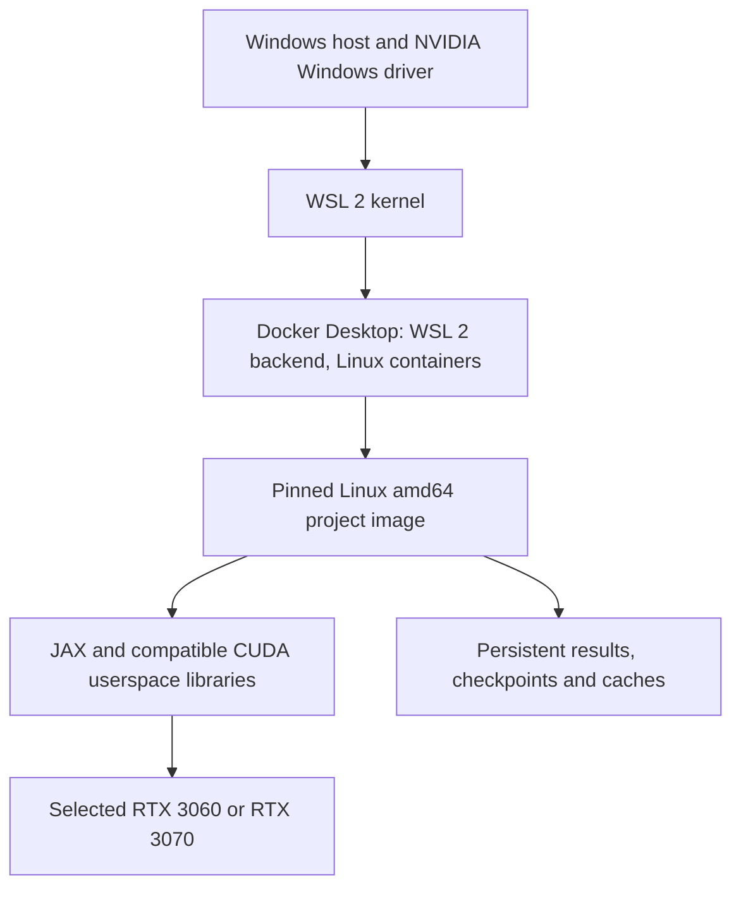

# Windows, Docker and NVIDIA execution specification

This document specifies deployment requirements. The Dockerfile and Compose profiles now implement the initial lane; actual inventory, dependency decisions and execution evidence are in [implementation.md](implementation.md). All project commands—including tests and CPU reference runs—execute inside Docker.

## 1. Execution stack

Docker Desktop supports NVIDIA passthrough to Linux containers through its WSL 2 backend. Select that backend explicitly rather than Windows-container mode or another virtualization backend. [Docker GPU documentation](https://docs.docker.com/desktop/features/gpu/)

The host needs a supported Windows installation, virtualization/WSL 2, Docker Desktop and a compatible NVIDIA Windows driver. These cannot be supplied solely by the application image. NVIDIA directs WSL users to use the Windows driver, without installing a Linux display driver in WSL. [NVIDIA WSL guide](https://docs.nvidia.com/cuda/wsl-user-guide/)

Use Docker Desktop’s documented integration first; do not also configure a second Docker daemon inside WSL. A native WSL Docker Engine setup would have separate NVIDIA Container Toolkit requirements and is an alternative to investigate only if Desktop creates a concrete blocker.

JAX supplies Linux CUDA wheels; its platform matrix still labels WSL2 GPU execution experimental. This is a feasible deployment route with a required qualification step, not a claim of measured parity with native Linux. [JAX installation](https://docs.jax.dev/en/latest/installation.html)

## 2. Image and dependency ownership

Q0 supplies the Dockerfile, Compose configuration, dockerignore, source checksums and Python locks. The following requirements remain acceptance criteria, independently of whether a smoke build succeeds.

- Base: a digest-pinned Linux/amd64 image supporting Python 3.11 and the required wheels. Resolve and record its distribution/system packages at Q0.
- Python: pin project dependencies, EMR source SHA, TensorNEAT submodule SHA and environment lock. Start with EMR’s JAX 0.6.1/CUDA 12 route.
- Environment suite: lock Gymnax and its transitive packages, Flax included, in the same resolution as the EMR JAX and NumPy pins. Resolve conflicts here, not when the adapter is written.
- CUDA: prefer compatible pip-provided CUDA libraries and JAX CUDA plugins inside the image. Pin transitive NVIDIA packages as well as JAX/JAXlib. Avoid mixing these with an unrelated system CUDA/cuDNN stack or overriding their library search path.
- Host: provides the NVIDIA driver. No project Python or CUDA toolkit installation on Windows is needed for the initial wheel-based runtime.
- Native kernels: if later work requires a CUDA compiler, introduce a separate compatible development/profiling image; do not burden the initial runtime with an unneeded toolchain.

JAX recommends pip-provided CUDA libraries as the simpler installation route. Use the requirements of the pinned JAX release rather than copying current-release CUDA version recommendations into an older EMR environment. [JAX installation](https://docs.jax.dev/en/latest/installation.html)

A container fixes userspace, not the host driver or WSL kernel. Record image digest, source revision, package lock, Windows build, driver, WSL kernel and Docker version in every benchmark manifest. Rebuild/requalify intentionally after upgrades.

## 3. Execution profiles

| Profile | Behavior |
|---|---|
| CPU reference | Same image; no GPU reservation; explicit CPU backend; correctness and deterministic reference tests |
| RTX 3060 | One selected GPU; strict identity/backend check; card-specific VRAM and microbatch settings |
| RTX 3070 | Same image; independently selected/qualified GPU; separately tuned physical batches |
| Profiling | Optional derived image/profile with qualified tracing tools; same application dependency versions |

Use Compose GPU reservations with a GPU capability and either a device count or device IDs, not both, but do not rely on them to isolate a card. The NVIDIA WSL guide states that on multi-GPU systems specific devices cannot be filtered by index and that only the all-GPUs request is supported. On a shared host, assume both cards are visible in every container. Each GPU profile selects its card inside the container before JAX initializes, through the CUDA device-visibility setting, and then verifies the selection: the visible device matches the profile by name and total memory, and JAX reports exactly one accelerator device. A mismatch stops the run. Qualify this mapping in Q0, together with the identity queries that work under WSL; it is the expected path, not a fallback. [Compose GPU configuration](https://docs.docker.com/compose/how-tos/gpu-support/), [NVIDIA WSL guide](https://docs.nvidia.com/cuda/wsl-user-guide/)

If both cards share a host, start with one experiment per card; if they are on separate machines, use the same image on each. Neither arrangement needs synchronous distributed JAX initially. Device memory is not pooled. Future islands or collective execution need their own communication and correctness qualification; heterogeneous devices can bottleneck synchronous work. One card is named the gating card at Q0; the roadmap defines what each card must pass per milestone.

## 4. Workspace and persistent storage

Keep the active checkout and high-I/O artifacts on the WSL Linux filesystem or Docker-managed volumes. Avoid a Windows-drive mount for frequent checkpoints, compilation caches and small-file-heavy builds; Docker documents better bind-mount performance with Linux-backed files. The Windows IDE can access the workspace through its WSL/container integration. [Docker WSL best practices](https://docs.docker.com/desktop/features/wsl/best-practices/)

Define explicit persistent locations for results, checkpoints, datasets, profiler traces and JAX compilation cache. Container replacement must not delete them. A development bind mount is useful for editing; acceptance runs use an immutable source revision and record any development mount. Separate cold-cache benchmarks from warm-cache runs. Partition caches by compatible software/runtime signature and let JAX validate cache entries; do not assume portability across differing GPUs or images.

Set explicit CPU/host-memory limits based on host inventory and WSL configuration. These do not cap VRAM. Set JAX allocator configuration before startup and measure both reservation and live memory; resource policy is in [benchmarks.md](benchmarks.md). [JAX GPU memory controls](https://docs.jax.dev/en/latest/gpu_memory_allocation.html)

NVIDIA lists GPU utilization and active-compute-process queries as unsupported in nvidia-smi under WSL. Memory and utilization evidence therefore comes from JAX profiling and from whichever device queries Q0 shows to work. [NVIDIA WSL guide](https://docs.nvidia.com/cuda/wsl-user-guide/)

## 5. Qualification order and challenge handling

1. Record host/GPU inventory and confirm WSL 2, driver and Docker prerequisites.
2. Run Docker’s documented GPU sample to establish passthrough; treat it as a smoke test, not a platform throughput benchmark.
3. Build the pinned project image. Confirm in-container card selection, GPU identity and a compiled JAX calculation on each card.
4. Execute Q1 primitives, TensorNEAT generations and Q2 EMR discovery/evaluation. Compare with CPU from the same image.
5. Establish VRAM, host-RAM and batch-size budgets. Run sustained benchmarks with display/background workload recorded.
6. Replace the container, reload a persisted checkpoint/artifact and verify continuation. Record image provenance and repeat the clean-start check on the other GPU host if applicable.

Likely challenges are driver/userspace compatibility, VRAM limits, filesystem placement, and WSL-specific profiler or communication limitations. Test these separately. Native Linux running the same image is a possible diagnostic/future deployment if a required WSL capability fails; it is not the default or an assumed necessary migration. No unsupported profiler counter is reported as zero, and a missing GPU never silently changes a GPU experiment into CPU execution.

The initial milestone remains a single-process neuroevolution engine. Docker/Compose provides the reproducible execution boundary; Kubernetes, a cluster scheduler and multi-service orchestration are unnecessary.
