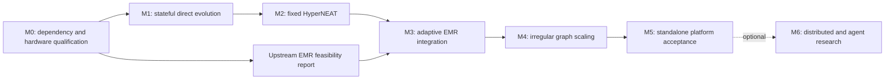

# Implementation roadmap and completion gates

This roadmap makes persistent recurrence early and adaptive EMR mandatory. Milestones are engineering gates, not calendar estimates. Each produces a runnable demonstration, machine-readable results, and a short benchmark/decision report. Tasks are defined in [tasks.md](tasks.md); common thresholds and workload definitions are in [benchmarks.md](benchmarks.md).

## Sequencing

M0’s container/dependency gate precedes executable integration. Its bounded upstream benchmark can run independently of M1 after the image is known to work. It must finish before major EMR adapter development. Correctness work can proceed in the CPU container while an infrastructure issue is diagnosed; GPU runs must fail explicitly if their device is unavailable.

**Gating card:** name one card at Q0, after inventory, as the gating card. The card with less VRAM is the default, because a memory profile that fits it also fits the other. A milestone closes, and the next may start, when its functional criteria pass in the CPU profile and its GPU gates pass on the gating card. The second card runs G1–G3 at each milestone and the full gate set at M5. Its open gates are listed in every milestone report and are never inherited from the gating card. Numerical thresholds are calibrated on the CPU profile and the gating card, then validated on the second card.

## M0 — Qualify dependencies and upstream feasibility

**Objective/scope:** establish a reproducible Docker stack for RTX 3060 and RTX 3070 on Windows/WSL 2 and determine whether upstream EMR has a credible bounded integration path. No platform framework yet.

**Tasks/dependencies:** Q0 defines the pinned image, Compose profiles, host prerequisites, mounts and cache persistence; Q1 verifies GPU passthrough, JAX primitives and complete TensorNEAT generations on each card; Q2 runs the upstream EMR benchmark matrix after Q0/Q1. Separate host-driver/WSL failures from container dependency failures before changing package versions.

**Deliverables:** immutable image digest and dependency lock; documented Windows/WSL host requirements; CPU and per-card run profiles; supported-feature matrix; baseline timing/memory tables for both cards; measured VRAM and host-memory envelopes; container restart/resume check.

**Validation/acceptance:** reference CPU smoke suite passes; each accepted GPU lane passes JIT, scan, RNG, gather/scatter, sorting/selection, and full generation tests. Run EMR feedforward and recurrent discovery separately with cache off at the bounded depths/populations in the benchmark plan. Record failures and limits, including compilation and host transfer costs. GPU numerical agreement must meet the differential-test policy. Device identity must be verified; CPU fallback is a failure of GPU qualification.

**Q2 screening criterion (proposed, per card):** upstream EMR completes the frozen Q2 manifest in benchmarks.md (max_depth=4, 1,364 candidate positions, P=128, 64 samples, cache off) inside that card’s VRAM and host-memory budgets and the W1 compile limit, with a median warm generation time of at most 28 s. Feed-forward and recurrent discovery are run separately and both must pass. The ceiling screens upstream discovery cost: a slower generation could not fit 250 generations into two hours even before rollout, compilation and evaluation are added. Passing it is feasibility evidence only. It does not establish the research budget, which G9 sets from a pilot on the integrated workload. max_depth=5 (5,460 candidates) is measured and reported, not gated. If a card misses the criterion, record a dated decision before A0, taking these in order: bounded query slabs or upstream streaming mode, then re-measure; a smaller declared adaptive envelope, with the thousands-of-nodes claim restricted to the synthetic fixture; another compute lane. A miss never becomes a silent substitution of fixed HyperNEAT.

**Risk/decision:** host driver, WSL passthrough or CUDA userspace mismatches can prevent startup. GPU qualification requires full workload execution on each target card; a device listing alone is insufficient. Work may begin on the gating card while the second awaits access, but the second card’s acceptance remains open. Do not replace the CUDA architecture because of an unresolved host configuration issue.

## M1 — Working stateful neuroevolution engine

**Objective/scope:** evolve small direct graphs while proving temporal memory independently. One process, one capacity, FP32, sum aggregation, tanh state nodes, one action head. Support a DAG profile and persistent synchronous profile without a general kernel optimizer. Freeze the semantics and reference fixtures of the persistent layered profile here; its JAX implementation arrives with the first substrate decoder in M2.

**Tasks/dependencies:** V0 contracts/configuration; V1 NumPy recurrent reference and delayed-cue task; V2 JAX runtime/planner; V3 TensorNEAT adapter/direct decoder; V4 batched evaluator and Gymnax control adapter; V5 generation runner, checkpoint, export and demo. See the detailed [first milestone](milestone-1.md).

**Deliverables:** reproducible local demonstration; evolving population and recorded topology changes; correct persistent hidden state; artifact reload; per-stage benchmark report.

**Validation/acceptance:** a fixed recurrent policy achieves 100% on the deterministic delayed-cue reference suite while a reset-every-step control obtains exactly 50% on balanced cues. A JAX population run agrees with the scalar reference and preserves state under chunking/permutation. Run 100 generations at P=128, N<=32, E<=128 over five declared seeds; retain every result. CartPole target is mean return >=450 over 20 held-out episodes in at least three seeds within the frozen evaluation budget. This is a research acceptance target, not an assumed outcome. The gated run uses feedforward genomes under the DAG profile. No unexpected recompilation after warm-up, no per-step host interaction, valid checkpoint continuation, and gates G1–G4 pass on the gating card. G5 is measured on W3 and reported, not gated, at this graph size.

**Reported diagnostics, not gated:** CartPole with recurrent genomes under the persistent synchronous profile, to quantify that profile’s latency cost; delayed-cue evolution with direct recurrent genomes under the memory-task manifest in benchmarks.md, to learn before any decoder exists whether NEAT finds a memory loop; and a fixed-scenario control for the stagnation measurement described in the architecture. These use a seed list disjoint from every acceptance set.

**Risk/decision:** direct-genome interpretation must match the chosen runtime profile. If the control learning target fails, diagnose action scaling, reward, operators, and evaluation before adding more topology complexity. The memory oracle proves execution, not that evolution has learned memory. If the direct-genome memory diagnostic fails in every seed, run the known-solution and weight-only controls then, before M2 depends on evolved memory.

## M2 — Fixed-substrate HyperNEAT and evolved memory

**Objective/scope:** evolve CPPNs through TensorNEAT and generate larger fixed-coordinate graphs using the same evaluator and graph contract, with the persistent layered profile added to the runtime. This is the integration bridge to EMR, not the project endpoint.

**Tasks/dependencies:** H0 CPPN query/decoder after V3; H1 numerical parity and phenotype export after V2/H0; H2 temporal-learning and scaling experiments after V4/H1; B0 fixed-topology weight-only baseline after V5 and H1. The CPPN remains small; phenotype capacity grows independently.

**Deliverables:** direct/fixed decoder selection by config; dense-block graph encoding; JAX persistent layered profile; fixed-substrate feedforward and persistent layered runs; coordinate definition and query conventions; the standing fixed-topology baseline; the system and encoding-isolating comparison reports defined in benchmarks.md.

The dense encoding keeps immediate and delayed matrices/masks separate. H1 must preserve a mixed-delay two-hidden-layer fixture through edge-list conversion and export/reload. Correctness and baseline timings use the explicit float32 matrix-product policy in benchmarks.md; no generic block-management framework is part of this milestone.

**Validation/acceptance:** compare generated weights to scalar CPPN queries on known coordinates; check masks and outputs on compatible upstream fixed-HyperNEAT configurations. Demonstrate 256 and 1,024-node execution fixtures in dense-block encoding, clearly distinguished from learned networks. Layered outputs match the float64 reference, and equal DAG outputs when no unit-delay edge exists. Evolve delayed-cue policies under the memory-task manifest in benchmarks.md; target interpolation accuracy >=90% in at least three of five seeds. Generalization to longer delays is reported separately. The G9 pilot confirms that the generation cap of the manifest fits the research budget before acceptance runs. CartPole maintains the M1 threshold under its declared budget. Run at least one connected recurrent phenotype end to end, not just a large allocation. G5 is gated here on the M2 gate cell named in benchmarks.md.

The memory and control tasks have two to four non-geometric inputs, so these gates establish integration and evolvability, not an advantage of indirect encoding. Two additions are reported, not gated. The first is a one-step visual-discrimination task on a small input grid, in the style of the HyperNEAT and EMR papers, run through the same evaluator for direct genomes, fixed substrates and the baseline. The second is W8, the shared-data long-horizon workload, which checks the evaluator contract.

**Risk/decision:** coordinate priors may limit search; recurrent dynamics may be hard to evolve. Compare encodings under the comparison protocol in benchmarks.md. If memory learning fails, run known-solution initialization and restricted weight-evolution controls to separate encoding/search problems from runtime errors.

## M3 — Adaptive EMR-HyperNEAT integration

**Objective/scope:** use genuine adaptive EMR discovery, evaluated by the project’s stateful rollout. Start with canonical variance behavior, a small activation set, sum aggregation, no slot cache, and a supported standard execution path. Add features one at a time.

**Tasks/dependencies:** A0 public API/capability adapter requires H1 and a passed or decided Q2 screening criterion; A1 EMR-to-graph conversion and reference comparisons requires A0; A2 persistent recurrent rollout and evolutionary experiments requires A1/H2. If a custom tell/evaluation seam is needed, add the smallest tested patch.

**Deliverables:** adaptive decoder; upstream-compatible settling profile; persistent layered profile for adaptive phenotypes; exact configuration provenance; genuine adaptive evolution demonstrations on memory and control; upstream comparison report.

**Validation/acceptance:** match upstream active-position sets and connection sets on non-boundary fixtures; numerical tolerances follow benchmarks.md. Test cap overflow and unsupported features explicitly. With hidden-to-hidden edges removed, layered-profile outputs match upstream feed-forward outputs within tolerance. Show at least two distinct active-node counts and edge sets across a run and prove a CPPN structural/parameter change can change the decoded graph. Reproduce the memory-task acceptance criterion with adaptive EMR within the budget fixed by its own G9 pilot, or document the failed research gate and diagnose it before declaring M3 complete. Preserve the CartPole criterion. Repeat the geometric diagnostic and both comparison reports. Pass end-to-end timing/memory gates with measured discovery, conversion and rollout costs; G5 is gated on the M3 gate cell named in benchmarks.md.

**Risk/decision:** extraction might rely on internal APIs; discovery might dominate; default EMR recurrent semantics differ from persistent carry. If performance fails, reduce temporary storage, chunk queries, and inspect per-genome discovery first. Locality, degree caps, variance changes, or dropped nodes require new experiment labels and a comparison against unmodified discovery. Do not silently substitute fixed HyperNEAT.

## M4 — Irregular topology execution and scale

**Objective/scope:** extend usable phenotype size and population size while preserving discovered connectivity. Introduce compaction, a small bucket family, and a measured dense-versus-edge-list runtime choice. Optimize only demonstrated bottlenecks.

**Tasks/dependencies:** S0 packing/bucketing follows A1; S1 alternate runtime follows V2/S0; S2 decoding/rollout memory scheduling follows A2/S1. Benchmark fixtures may be generated earlier, but optimize against actual EMR graph distributions.

**Deliverables:** lossless planner; bounded microbatch scheduler; runtime crossover map by node count, edge count, degree distribution, B and K; CPU/GPU scaling report; an alternate runtime adopted only where G8 passes, otherwise the recorded decision to retain dense.

**Validation/acceptance:** dense and alternate runtimes agree on random cyclic graphs, self-loops, disconnected graphs, duplicate-edge policy, and adversarial degree distributions. Run at least 100 measured generations without new signatures after warming supported buckets. Demonstrate P=256 logical agents, N=2,048 nodes, E<=32,768 edges per graph, B=4, T=128, K=1 on a declared synthetic irregular workload using bounded microbatches; report actual active counts. Also run a substrate-shaped dense-block fixture at the same N with a 400-wide input block, because evolved substrates carry dense input and output blocks that the sparse fixture does not represent. Separately demonstrate an evolved EMR population at its measured feasible envelope; do not force thousands of inactive nodes into the graph to claim success. Complete the longer stability run and performance budget in benchmarks.md. G5 is gated on the evolved-EMR generation at its measured envelope; the W6 rollout ratio is reported beside it.

**Risk/decision:** sparse execution can be slower; VRAM limits and padding can dominate; WSL profiling may expose fewer counters. Keep the fastest correct implementation per workload family. A custom kernel requires a measured bottleneck and a portable fallback. Report the feasible envelope separately for each card and leave over-budget cells unpassed.

## M5 — Standalone platform acceptance

**Objective/scope:** consolidate a useful, documented platform before introducing markets. Validate on a more demanding control or game environment and prove artifact portability and component replacement.

**Tasks/dependencies:** P0 adds a compatible Gymnax MinAtar or partially observed control experiment after A2; P1 assembles acceptance evidence after S2/P0. Prefer MinAtar initially; a physics suite is optional if its dependencies fit the qualified lane.

**Deliverables:** reproducible examples for all three decoders; complete experiment manifests; export/reload documentation; end-to-end benchmark dossier; limitations and supported capability matrix.

**Validation/acceptance:** all mandatory gates below pass. For the harder task, freeze a held-out protocol before tuning: at least five independent evolution seeds, fixed budget, and 100 held-out episodes per final policy. Target median normalized improvement over a random-action baseline of at least 20%, using a declared positive normalization scale, plus a positive bootstrap 95% interval for paired improvement; resample training runs as the primary independent unit, not thousands of correlated episodes. The exact task/normalizer is registered in P0 after a pilot and before acceptance runs. Failure does not erase the benchmark; it leaves the capability gate open. Report every decoder and the fixed-topology baseline on this task under the comparison protocol.

**Risk/decision:** a simulator may dominate or reward exploitation may masquerade as learning. Compare against action baselines and the standing fixed-topology baseline; an external evolution-strategy library is an optional addition where dependency-compatible. Inspect full trajectories for finalists.

## M6 — Optional subsequent research

After M5, add multi-device islands, gradient-assisted evolution, module/developmental encodings, or cooperative/competitive agents as separate experiments. X0 can demonstrate two-device islands; X1 can demonstrate a bounded two-actor team task. Neither is necessary to finish the first standalone platform.

**Acceptance for an extension:** preserve core contracts or version semantics explicitly; demonstrate it with its own baseline, correctness suite, and compute budget. For islands, migration must preserve gene identity, reevaluate on receiver scenarios, and report transfer costs and quality under the comparison protocol. Multi-GPU throughput has no assumed linear speedup.

## Definition of done for the standalone platform

M5 closes only when all of the following evidence exists:

- Direct, fixed-HyperNEAT, and adaptive EMR evolution work through the same application-independent evaluator.
- Persistent recurrence passes deterministic memory tests and evolved-memory held-out acceptance. State resets, truncation and chunk continuation are correct.
- At least one real control task and one harder control/game task meet their frozen research targets across multiple seeds.
- Irregular recurrent graphs remain representable; compaction/runtime changes preserve semantics; every overflow is visible.
- A clean Docker build from immutable inputs can reproduce demonstrations, reload artifacts, and resume from persisted checkpoints after container replacement under the declared determinism policy.
- Performance reports contain compilation, discovery, planning, runtime, simulation, evolution, end-to-end throughput, and memory. Both RTX 3060 and RTX 3070 profiles pass the GPU gates independently; results from one card cannot close the other card’s qualification.
- The thousands-of-nodes execution fixture passes on a qualified accelerator, with active edge/node counts and microbatch sizes disclosed. Learned EMR size is reported independently.
- Replacing direct decoding with fixed or EMR decoding requires configuration/adapters, not changes to environment or fitness code. The float64 NumPy reference is the second numerical runtime that passes the same contract tests. An accelerated alternate layout is adopted only if it passes G8; otherwise the crossover measurements and the recorded decision to retain dense close this item.
- System and encoding-isolating comparisons of direct genomes, fixed HyperNEAT, adaptive EMR and the fixed-topology weight-only baseline exist for every acceptance task, under the comparison protocol in benchmarks.md. They are required reports, not pass/fail gates, and an encoding that loses is reported as losing.
- Every acceptance experiment ran inside a research budget confirmed beforehand by a G9 pilot on its own integrated workload.
- The evaluator contract has been exercised by the shared-data long-horizon workload W8.
- Tests and docs contain no dependency on market data or trading concepts. Trading remains a later application.

A failed empirical target is an experiment result and a reason for a scoped redesign. Revise a gate only with a dated decision explaining why; never relabel an unsuccessful run as completion or tune against held-out acceptance seeds.
